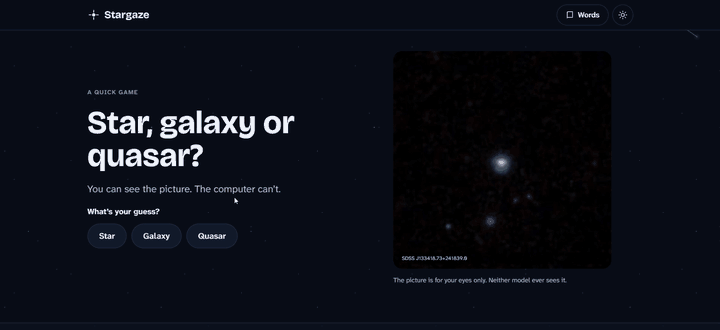
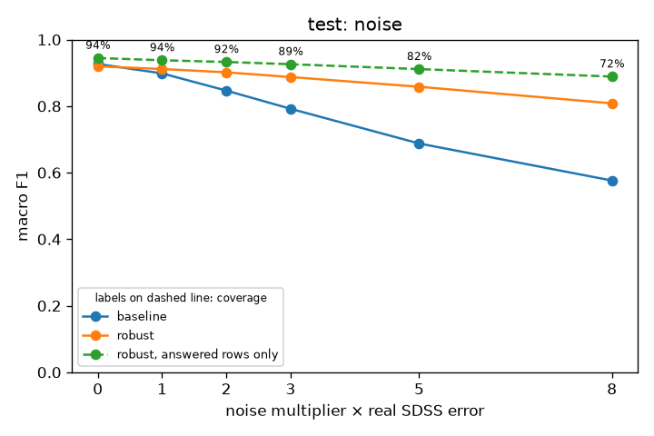
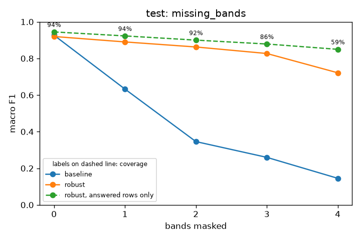

# Stargaze

Tells stars, galaxies and quasars apart from five brightness measurements, and keeps working when those measurements are noisy, incomplete or wrong. When it can't be trusted, it says *not sure* instead of guessing.

**Try it:** https://stargaze.automate-tasks.workers.dev/ (guided stories, opens instantly)



Or the original Streamlit version, where you can type in your own numbers: https://stargaze-hwfa7cmwc3b2ucbqmemtvy.streamlit.app/ (free hosting: if it has been idle, it takes about a minute to wake up)

## The idea in plain words

A telescope survey such as the [Sloan Digital Sky Survey](https://www.sdss.org/) (SDSS) measures how bright each object in the sky is through five colour filters, from ultraviolet to infrared. Those five numbers are cheap to get for hundreds of millions of objects. Splitting the light into a full spectrum, which tells you for sure what an object is, is slow and expensive.

So: from the five numbers alone, can a computer tell a **star** (a sun in our own galaxy), a **galaxy** (billions of stars, far away) and a **quasar** (a distant galaxy's core lit up by a giant black hole, which looks deceptively like a star)?

It can, on clean data: an ordinary model gets about 93 out of 100. But real measurements are often bad: faint objects are noisy, a filter can miss an object, files get typos. An ordinary model trained on clean data then keeps answering, confidently and wrongly. Stargaze is built for that:

1. **It learns from damaged copies.** Besides the clean measurements, it practises on copies with extra noise, missing colours and impossible values.
2. **It checks its input.** Impossible values (a brightness no real object has) are caught and removed before the model sees them.
3. **It knows when to stop.** If its confidence is too low, the input looks unlike anything it learned from, or the colours left are known to mislead it, it answers *not sure*.

## What we found

Tested once, at the end, on 37,775 objects neither model had ever seen. Score out of 100 (macro F1: how often a model is right, with stars, galaxies and quasars counting equally):

| The measurements are... | Ordinary model | Stargaze |
|---|---|---|
| Clean | 93 | 92 |
| 8× noisier than normal | 58 | 81 |
| Missing 1 of 5 colours | 63 | 89 |
| Missing 2 of 5 colours | 35 | 86 |
| Missing 4 of 5 colours | 15 | 72 |

When Stargaze says *not sure*, that counts as wrong in this table. On the objects it does answer, it is right about 92% of the time even in the worst rows above. It answers 72% of objects at 8× noise and 59% with four colours missing.

| As the noise grows | As colours go missing |
|---|---|
|  |  |

The orange line is Stargaze on all objects; the dashed green line is Stargaze on the objects it chose to answer, labelled with the share it answered.

**Honest caveats**

- On clean data, Stargaze trails a model that is also given each object's distance (redshift, which only the expensive spectrum provides) by 6.7 points; the goal was at most 7. The 95% interval is 6.5–7.1, so the result is consistent with the goal but doesn't prove it.
- On 31,279 objects that SDSS itself marks as having questionable measurements, Stargaze scores slightly lower than the ordinary model (82 vs 84). It declines 10% of them, and scores 86 on the rest.
- With only the ultraviolet filter left, Stargaze was confidently wrong during development. It now always answers *not sure* for that case.
- **On another telescope's data it mostly declines.** On 44,700 objects from the DESI survey, which measures only three of the five colours and doesn't separate point-like from spread-out light, Stargaze answers 39% of objects and is right on 91% of those (helped by DESI's sample being 70% galaxies; with each type counting equally, 62 out of 100). Its outlier check never flagged the other telescope's data as unusual, so the declining comes from low confidence alone. Its overall score is 50 vs 45 for the ordinary model, which never recognises a quasar from those three colours. Most of the drop comes from the missing information rather than the different telescope: on SDSS validation data cut down to the same three colours, Stargaze also answers only 31% (its thresholds were tuned on that data, so this reference is slightly flattering). Details in [reports/desi/](reports/desi/).

## How it was built

**Data.** 283,108 SDSS DR17 objects with spectroscopic labels, pulled from the public SDSS archive with saved SQL ([sql/](sql/)), then cleaned in three layers (bronze → silver → gold). Inputs: the five PSF magnitudes, four colours and PSF − model magnitude per band ([why](docs/decisions/0002-psf-minus-model-features.md)). Redshift is used only for the comparison model above, never as an input.

**Models.** Histogram gradient boosting (scikit-learn). The ordinary model trains on clean data; the robust model also trains on two damaged copies of each training object (noise 1–5× the real SDSS errors, 15% of bands masked, 2% impossible values). Damaged copies are made after the train/validation/test split, from the training split only, so no test object leaks into training.

**Trust layer.** Temperature-scaled calibration (expected calibration error on test: 0.006, target ≤ 0.05), an Isolation Forest for unusual inputs, a confidence threshold, and a list of band combinations that mislead the model. All thresholds were tuned on the validation split. The test split was scored exactly once ([reports/test/](reports/test/)).

**Results in full.** The headline comparisons with paired-bootstrap 95% intervals, plus charts for calibration, coverage vs accuracy and SHAP feature importance, is in [reports/test/](reports/test/) (`metrics.json` holds every number). Validation results are in [reports/val/](reports/val/), the cross-survey check on DESI in [reports/desi/](reports/desi/).

## Run it yourself

Needs Python 3.12 and [uv](https://docs.astral.sh/uv/). The trained models and a 1,000-object sample are in the repo, so the demo and API run without downloading any data.

```sh
uv sync
uv run streamlit run streamlit_app.py        # the demo
uv run uvicorn stargaze.api:app              # the API; docs at http://127.0.0.1:8000/docs
uv run pytest                                # tests
```

The interactive web demo (React + Tailwind, in `web/`) needs Node 22. It shows the shipped models' real answers, worked out in advance for every damage the page offers, so it is a static site with no server:

```sh
uv run python -m stargaze.export_demo        # after any retraining: refresh web/src/generated/answers.json
cd web && npm ci && npm run dev              # http://localhost:5173
npm run build                                # static site in web/dist, ready for any free host
```

The API takes the five PSF magnitudes (`u` … `z`), optionally the model magnitudes (`u_model` … `z_model`), with `null` for missing, and `"model": "robust"` or `"baseline"`:

```sh
curl -X POST http://127.0.0.1:8000/predict -H "Content-Type: application/json" \
  -d '{"u": 19.2, "g": 17.8, "r": null, "i": 16.9, "z": 16.7, "model": "robust"}'
```

To rebuild everything from the SDSS archive (about 1 minute of downloading, then a few minutes of training):

```sh
uv run python -m stargaze.bronze             # pull SDSS DR17 into data/bronze/ (resumable)
uv run python -m stargaze.silver             # clean
uv run python -m stargaze.gold               # features
uv run python -m stargaze.split              # train / validation / test
uv run python -m stargaze.train              # ordinary, robust and comparison models
uv run python -m stargaze.trust              # calibration, unusual-input detector, threshold
uv run python -m stargaze.evaluate           # validation reports and charts
uv run python -m stargaze.desi               # cross-survey check on DESI DR1
```

The test split has already been scored once (`reports/test/`); `stargaze.evaluate --test` refuses to run again.

## Project

Built by Kurt and Jude. Everything runs on free tools and free hosting. Data: [SDSS DR17](https://www.sdss4.org/dr17/). Licence: [MIT](LICENSE).
